# sma1220医院门诊预约挂号系统hsg5378AHY3-1

> 🎓 **计算机毕业设计 · sma1220医院门诊预约挂号系统hsg5378AHY3-1**
>
> 本仓库只放**项目介绍 + 运行截图**（截图是站点带水印的原图，存在仓库 `images/` 里）。
>
> 👉 **完整可运行源码 / 数据库脚本 / 部署文档：[点我获取](https://geekcode.top/archives/sma1220%E5%8C%BB%E9%99%A2%E9%97%A8%E8%AF%8A%E9%A2%84%E7%BA%A6%E6%8C%82%E5%8F%B7%E7%B3%BB%E7%BB%9Fhsg5378AHY3-1?utm_source=github)**
>
> 💬 咨询微信：**ir9372**　|　🌐 更多项目：[极客代码 geekcode.top](https://geekcode.top/?utm_source=github)
>
> 📌 项目详情页：<https://geekcode.top/archives/sma1220%E5%8C%BB%E9%99%A2%E9%97%A8%E8%AF%8A%E9%A2%84%E7%BA%A6%E6%8C%82%E5%8F%B7%E7%B3%BB%E7%BB%9Fhsg5378AHY3-1?utm_source=github>

<table><td width="230" align="center"> <b>扫码加微信 ir9372</b></td><td valign="middle">📦 源码 = 项目介绍 + 全部运行截图 + 数据库 + 部署文档 👉 点上方任意截图，直接跳到 <b>极客代码 geekcode.top</b> 详情页</td></table>

---

<h1>sma1220医院门诊预约挂号系统hsg5378AHY3-1</h1>
<h2>项目概述</h2>

本项目名为“医院门诊预约挂号系统”，旨在解决传统医院门诊挂号排队时间长、资源分配不均等痛点，实现医疗资源的数字化管理。系统基于 SSM（Spring + Spring MVC + MyBatis）框架与 JSP 技术构建，采用单体架构设计，专注于后台数据管理与业务逻辑处理。核心功能涵盖科室信息管理、医生信息维护、排班计划制定、患者注册登录以及预约挂号流程。适用人群主要为医院管理人员及就诊患者。由于该项目定位为后端管理型系统，前端交互界面主要服务于管理员对基础数据的增删改查操作，通过标准化的 Web 页面展示列表与编辑表单，确保数据的准确性与实时性。

<h2>技术架构</h2>

本系统采用经典的 Java Web 三层架构进行开发，技术选型注重稳定性与易维护性。

<ol>
<li><strong>后端框架</strong>：使用 SSM 组合。Spring 负责依赖注入与事务管理，保障业务逻辑的解耦；Spring MVC 处理 HTTP 请求分发，实现控制器与视图的分离；MyBatis 作为持久层框架，通过 XML 映射文件灵活配置 SQL 语句，高效操作数据库。</li>
<li><strong>前端技术</strong>：采用 JSP（JavaServer Pages）作为视图层技术。JSP 允许在 HTML 中嵌入 Java 代码片段，能够直接渲染后端传递的数据模型，适合快速构建动态网页，特别是在需要频繁刷新列表和表单的场景下表现良好。</li>
<li><strong>数据库设计</strong>：虽然具体表结构未提供详细 DDL，但根据功能模块推断，数据库需包含用户表、科室表、医生表、排班表、预约记录表及新闻公告表等。各表之间通过外键关联，例如预约记录需关联具体的排班信息和患者 ID，以确保数据的一致性。</li>
<li><strong>核心技术理由</strong>：SSM+JSP 组合是高校毕业设计中的经典方案，具备成熟的社区支持和丰富的文档资源，便于开发者快速搭建原型并聚焦于业务逻辑的实现，而非复杂的前端工程化配置。</li>
</ol>
<h2>功能模块</h2>

根据截图提供的页面列表，系统主要划分为以下功能模块，所有操作均通过统一的 Web 界面完成：

<h3>1. 基础信息管理模块</h3>
<ul>
<li><strong>科室信息管理</strong>：对应“ksxx列表”及“科室信息列表”页面。支持查看现有科室列表，执行新增、修改、删除及查询操作，维护医院的基本诊疗科目。</li>
<li><strong>医生信息管理</strong>：对应“ysxx列表”及“yishengxinxi列表”页面。用于录入医生基本信息（如姓名、职称、所属科室等），并提供检索功能以便快速定位特定医生档案。</li>
</ul>
<h3>2. 业务运营模块</h3>
<ul>
<li><strong>排班信息管理</strong>：对应“pbxx列表”及“排班信息列表”页面。管理员可设定医生的出诊时间、号源数量等排班计划，这是预约挂号的核心数据支撑。</li>
<li><strong>预约挂号管理</strong>：对应“yuyueguahao列表”页面。展示患者的预约记录，支持对预约状态进行审核、取消或确认，连接患者需求与医生排班资源。</li>
</ul>
<h3>3. 用户与内容管理模块</h3>
<ul>
<li><strong>用户管理</strong>：对应“allusers列表”及“yonghuzhuce列表”页面。包含注册用户的管理，可查看用户详细信息，执行禁用或删除操作，同时可能涉及用户注册信息的审核或展示。</li>
<li><strong>新闻公告管理</strong>：对应“xinwentongzhi列表”页面。用于发布医院通知、就诊指南或健康资讯，支持内容的更新与维护。</li>
<li><strong>友情链接管理</strong>：对应“youqinglianjie列表”页面。管理系统外部链接资源，通常用于展示合作机构或相关卫生部门网站。</li>
</ul>
<h3>4. 系统入口模块</h3>
<ul>
<li><strong>登录认证</strong>：对应“登录页”。提供身份验证入口，确保只有授权人员才能访问上述管理功能。</li>
</ul>
<h2>用户角色与权限</h2>

鉴于项目描述中标注“是否有前台: 否”、“是否有后台: 否”且无明确的角色路由区分，结合 SSM+JSP 的传统毕设模式，推测系统主要面向单一管理员角色进行全量数据管理，或通过简单的会话机制区分普通注册用户与管理者。

<strong>1. 系统管理员</strong>

<ul>
<li><strong>权限范围</strong>：拥有最高权限，可访问所有列出的功能页面。</li>
<li><strong>具体操作</strong>：</li>
<li>在“登录页”进入系统。</li>
<li>在“allusers列表”中管理所有用户账号。</li>
<li>在“ksxx列表”、“ysxx列表”、“pbxx列表”中维护科室、医生及排班基础数据。</li>
<li>在“yuyueguahao列表”中处理所有预约请求。</li>
<li>在“xinwentongzhi列表”和“youqinglianjie列表”中发布和维护公共信息。</li>
<li>通过“页面-编辑 (admin)”对各实体数据进行详细的字段级修改。</li>
</ul>

<strong>2. 普通用户（假设存在）</strong>

<ul>
<li><strong>权限范围</strong>：根据“yonghuzhuce列表”的存在，系统支持用户注册。若存在独立的用户视角，其权限应限于个人数据。</li>
<li><strong>具体操作</strong>：</li>
<li>注册并登录系统。</li>
<li>查看“科室信息”和“医生信息”以选择就诊对象。</li>
<li>依据“排班信息”发起“预约挂号”。</li>
<li>查看个人的“新闻公告”接收情况。</li>
<li><em>注：由于截图仅展示了管理类列表页，未展示具体的用户自助服务界面，故普通用户的详细交互路径基于常规逻辑推断，实际功能以代码为准。</em></li>
</ul>
<h2>项目特色与创新点</h2>
<ol>
<li><strong>全流程闭环管理</strong>：系统覆盖了从基础数据（科室、医生）到动态资源（排班）再到最终服务（预约）的完整链条，确保了医疗业务流程的逻辑连贯性。</li>
<li><strong>结构化数据展示</strong>：通过多个独立的列表页面（如 ksxx, ysxx, pbxx）清晰隔离不同维度的业务数据，降低了管理员的认知负荷，提高了数据查找与维护的效率。</li>
<li><strong>轻量级技术栈应用</strong>：摒弃了复杂的前端框架，直接使用 JSP 进行服务端渲染，减少了前后端联调的成本，非常适合中小型规模的数据管理场景，体现了务实的工程思维。</li>
<li><strong>模块化编辑体验</strong>：专门的“编辑”页面设计表明系统采用了表单驱动的数据更新模式，保证了数据提交的规范性与完整性校验的有效性。</li>
</ol>
<h2>部署环境</h2>

为确保系统正常运行，建议准备以下软件环境：

<ol>
<li><strong>操作系统</strong>：Windows 7/10/11 或 Linux (CentOS 7+)。</li>
<li><strong>Java 运行环境</strong>：JDK 1.8 或更高版本（需配置 JAVA_HOME 环境变量）。</li>
<li><strong>Web 服务器</strong>：Apache Tomcat 8.5 或 9.0 版本（用于部署 WAR 包或运行 JSP 页面）。</li>
<li><strong>数据库</strong>：MySQL 5.7 或 MySQL 8.0。需安装 MySQL Server 及客户端工具（如 Navicat 或 Workbench）用于导入初始化脚本。</li>
<li><strong>开发工具</strong>：IntelliJ IDEA 或 Eclipse（用于代码编写、调试及 Maven/Gradle 依赖管理）。</li>
<li><strong>浏览器</strong>：Chrome、Edge 或 Firefox 最新版，用于访问系统界面。</li>
</ol>

<strong>启动步骤简述</strong>：

<ol>
<li>启动 MySQL 服务，创建数据库并导入 SQL 脚本。</li>
<li>修改项目配置文件（如 <code>application.properties</code> 或 <code>jdbc.properties</code>）中的数据库连接 URL、用户名和密码。</li>
<li>在 IDE 中配置 Tomcat 服务器，将项目部署至 Tomcat。</li>
<li>启动 Tomcat，通过浏览器访问 <code>http://localhost:8080/[项目名]/login.jsp</code> 进入登录页开始使用。</li>
</ol>
<h2>五、技术特性</h2>
<ul>
<li>服务端模板渲染（JSP）</li>
</ul>
<h2>六、功能模块截图</h2>
<h3>前台用户端</h3>
<h4>页面-科室信息列表</h4>

<a href="https://geekcode.top/archives/sma1220%E5%8C%BB%E9%99%A2%E9%97%A8%E8%AF%8A%E9%A2%84%E7%BA%A6%E6%8C%82%E5%8F%B7%E7%B3%BB%E7%BB%9Fhsg5378AHY3-1?utm_source=github" title="查看完整源码">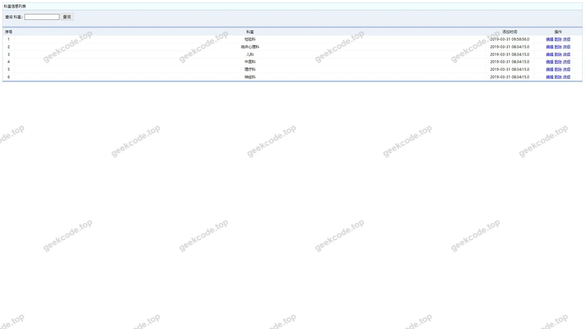</a>

<h4>页面-ksxx列表</h4>

<a href="https://geekcode.top/archives/sma1220%E5%8C%BB%E9%99%A2%E9%97%A8%E8%AF%8A%E9%A2%84%E7%BA%A6%E6%8C%82%E5%8F%B7%E7%B3%BB%E7%BB%9Fhsg5378AHY3-1?utm_source=github" title="查看完整源码">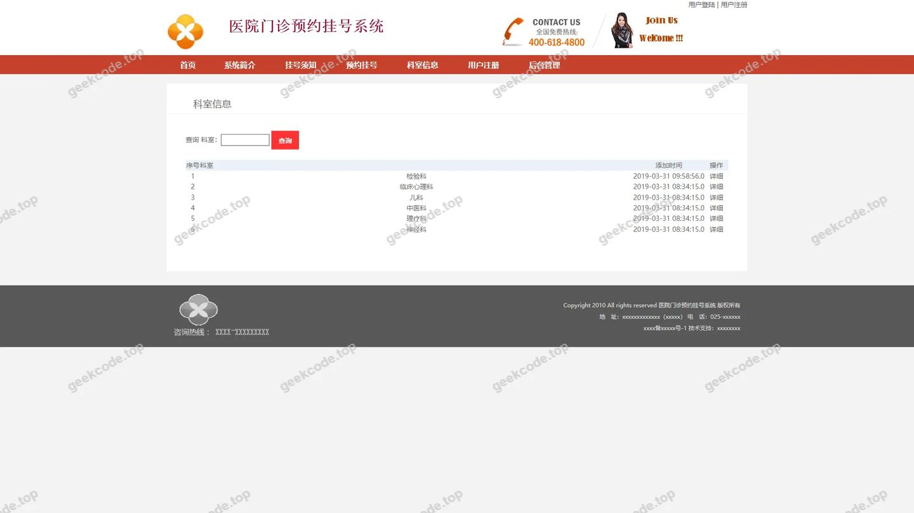</a>

<h4>页面-xinwentongzhi列表</h4>

<a href="https://geekcode.top/archives/sma1220%E5%8C%BB%E9%99%A2%E9%97%A8%E8%AF%8A%E9%A2%84%E7%BA%A6%E6%8C%82%E5%8F%B7%E7%B3%BB%E7%BB%9Fhsg5378AHY3-1?utm_source=github" title="查看完整源码">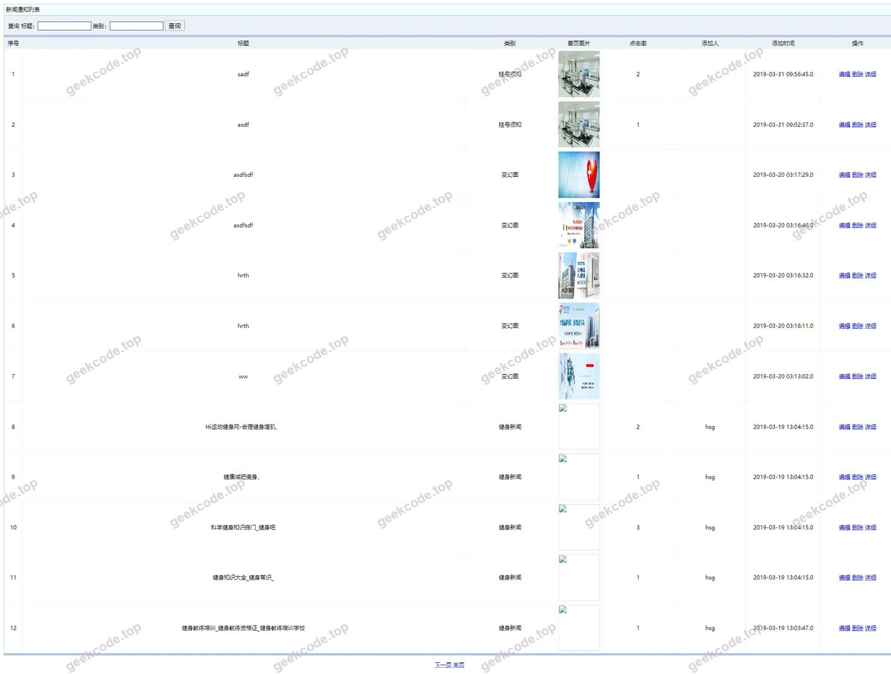</a>

<h4>页面-yonghuzhuce列表</h4>

<a href="https://geekcode.top/archives/sma1220%E5%8C%BB%E9%99%A2%E9%97%A8%E8%AF%8A%E9%A2%84%E7%BA%A6%E6%8C%82%E5%8F%B7%E7%B3%BB%E7%BB%9Fhsg5378AHY3-1?utm_source=github" title="查看完整源码">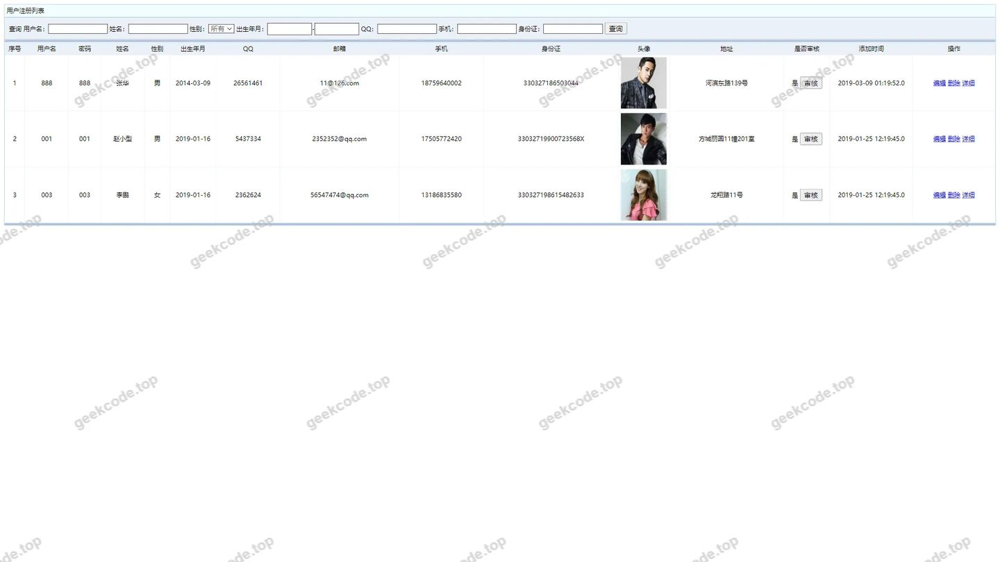</a>

<h4>页面-youqinglianjie列表</h4>

<a href="https://geekcode.top/archives/sma1220%E5%8C%BB%E9%99%A2%E9%97%A8%E8%AF%8A%E9%A2%84%E7%BA%A6%E6%8C%82%E5%8F%B7%E7%B3%BB%E7%BB%9Fhsg5378AHY3-1?utm_source=github" title="查看完整源码">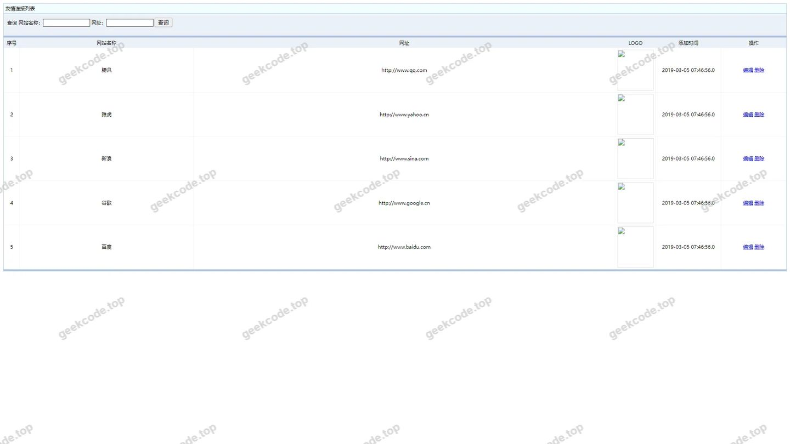</a>

<h4>页面-编辑</h4>

<h3>后台管理端</h3>
<h4>登录页</h4>

<a href="https://geekcode.top/archives/sma1220%E5%8C%BB%E9%99%A2%E9%97%A8%E8%AF%8A%E9%A2%84%E7%BA%A6%E6%8C%82%E5%8F%B7%E7%B3%BB%E7%BB%9Fhsg5378AHY3-1?utm_source=github" title="查看完整源码">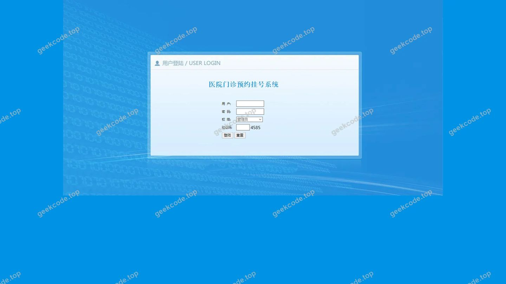</a>

<h4>页面-排班信息列表</h4>

<a href="https://geekcode.top/archives/sma1220%E5%8C%BB%E9%99%A2%E9%97%A8%E8%AF%8A%E9%A2%84%E7%BA%A6%E6%8C%82%E5%8F%B7%E7%B3%BB%E7%BB%9Fhsg5378AHY3-1?utm_source=github" title="查看完整源码">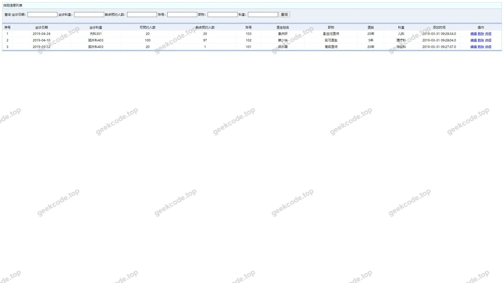</a>

<h4>页面-allusers列表</h4>

<a href="https://geekcode.top/archives/sma1220%E5%8C%BB%E9%99%A2%E9%97%A8%E8%AF%8A%E9%A2%84%E7%BA%A6%E6%8C%82%E5%8F%B7%E7%B3%BB%E7%BB%9Fhsg5378AHY3-1?utm_source=github" title="查看完整源码">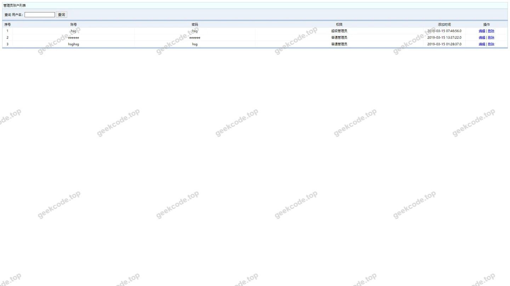</a>

<h4>页面-pbxx列表</h4>

<a href="https://geekcode.top/archives/sma1220%E5%8C%BB%E9%99%A2%E9%97%A8%E8%AF%8A%E9%A2%84%E7%BA%A6%E6%8C%82%E5%8F%B7%E7%B3%BB%E7%BB%9Fhsg5378AHY3-1?utm_source=github" title="查看完整源码">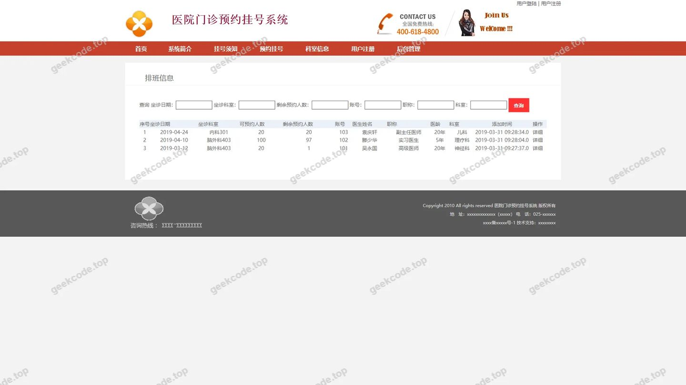</a>

<h4>页面-yishengxinxi列表</h4>

<a href="https://geekcode.top/archives/sma1220%E5%8C%BB%E9%99%A2%E9%97%A8%E8%AF%8A%E9%A2%84%E7%BA%A6%E6%8C%82%E5%8F%B7%E7%B3%BB%E7%BB%9Fhsg5378AHY3-1?utm_source=github" title="查看完整源码">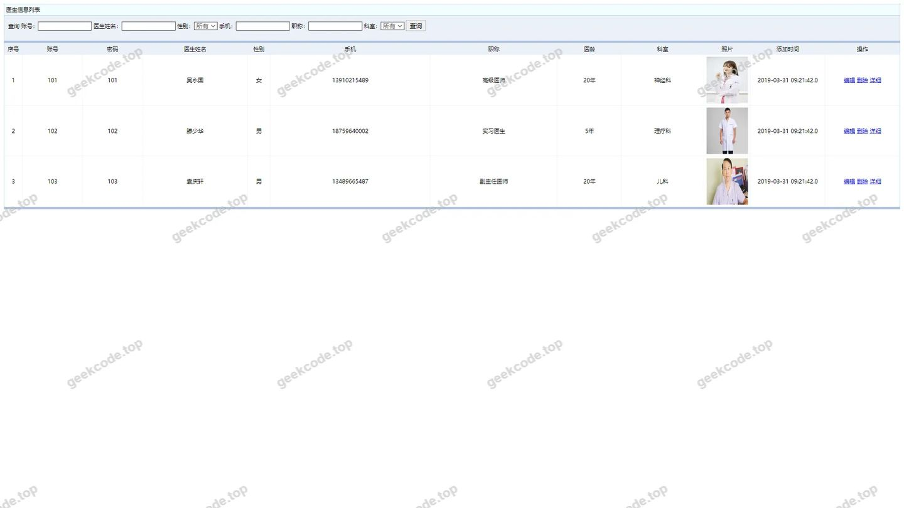</a>

<h4>页面-ysxx列表</h4>

<a href="https://geekcode.top/archives/sma1220%E5%8C%BB%E9%99%A2%E9%97%A8%E8%AF%8A%E9%A2%84%E7%BA%A6%E6%8C%82%E5%8F%B7%E7%B3%BB%E7%BB%9Fhsg5378AHY3-1?utm_source=github" title="查看完整源码">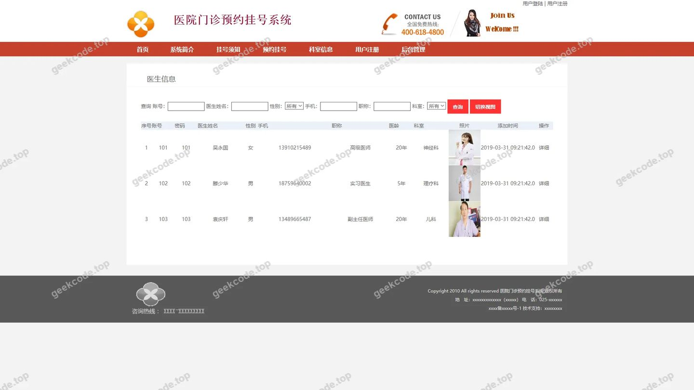</a>

<h4>页面-yuyueguahao列表</h4>

<a href="https://geekcode.top/archives/sma1220%E5%8C%BB%E9%99%A2%E9%97%A8%E8%AF%8A%E9%A2%84%E7%BA%A6%E6%8C%82%E5%8F%B7%E7%B3%BB%E7%BB%9Fhsg5378AHY3-1?utm_source=github" title="查看完整源码">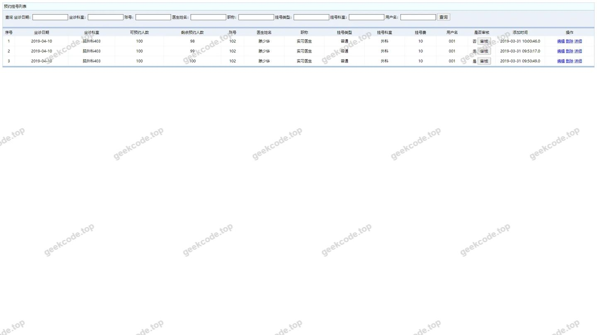</a>

---

## 获取完整源码

| 项目 | 说明 |
| --- | --- |
| 项目名 | sma1220医院门诊预约挂号系统hsg5378AHY3-1 |
| 运行截图 | 本文 13 张（站点带水印原图，仓库 `images/` 目录） |
| 完整源码 | [https://geekcode.top/archives/sma1220%E5%8C%BB%E9%99%A2%E9%97%A8%E8%AF%8A%E9%A2%84%E7%BA%A6%E6%8C%82%E5%8F%B7%E7%B3%BB%E7%BB%9Fhsg5378AHY3-1?utm_source=github](https://geekcode.top/archives/sma1220%E5%8C%BB%E9%99%A2%E9%97%A8%E8%AF%8A%E9%A2%84%E7%BA%A6%E6%8C%82%E5%8F%B7%E7%B3%BB%E7%BB%9Fhsg5378AHY3-1?utm_source=github) |
| 咨询微信 | **ir9372**（备注：jingpin-yuanma） |
| 更多项目 | [极客代码 geekcode.top](https://geekcode.top/?utm_source=github) |

> 需要源码、部署、改配置、跑不起来等问题，加微信 ir9372 沟通，说明项目名即可。
